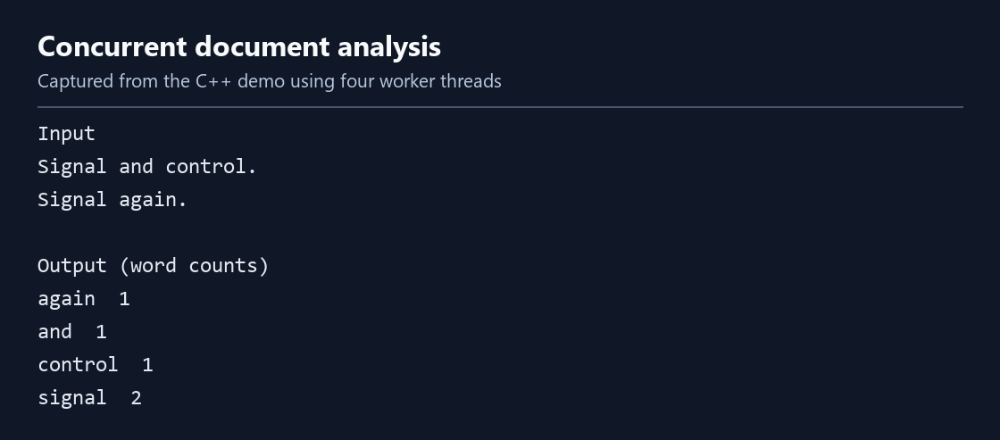

# Concurrent Document Analysis Demo

A C++ command-line example based on the producer–consumer design I used in my C++/Qt document analyzer. In the original application, worker threads handled analysis off the UI thread. I also added QTest cases for the desktop application.



**What to look for.** Two input lines produce four distinct words. `signal` appears twice. The program combines each worker's counts and outputs them alphabetically.

This example queues text lines for workers, counts words, and prints frequencies in alphabetical order. A condition variable lets idle workers sleep. After input ends, the queue closes, workers finish the remaining items, and the main thread joins them before merging their counts. The demo is limited to ASCII word tokenization and does not include the original Qt interface, course assets, or lexicon.

The command-line demo was prepared with AI assistance as a companion to the original Qt application.

Build with a C++17 compiler. Run `--check` to compare single-worker and parallel results against known counts.

```sh
g++ -std=c++17 -pthread -Wall -Wextra -pedantic main.cpp -o analyzer
./analyzer --check
printf 'Signal and control.\nSignal again.\n' | ./analyzer
```
